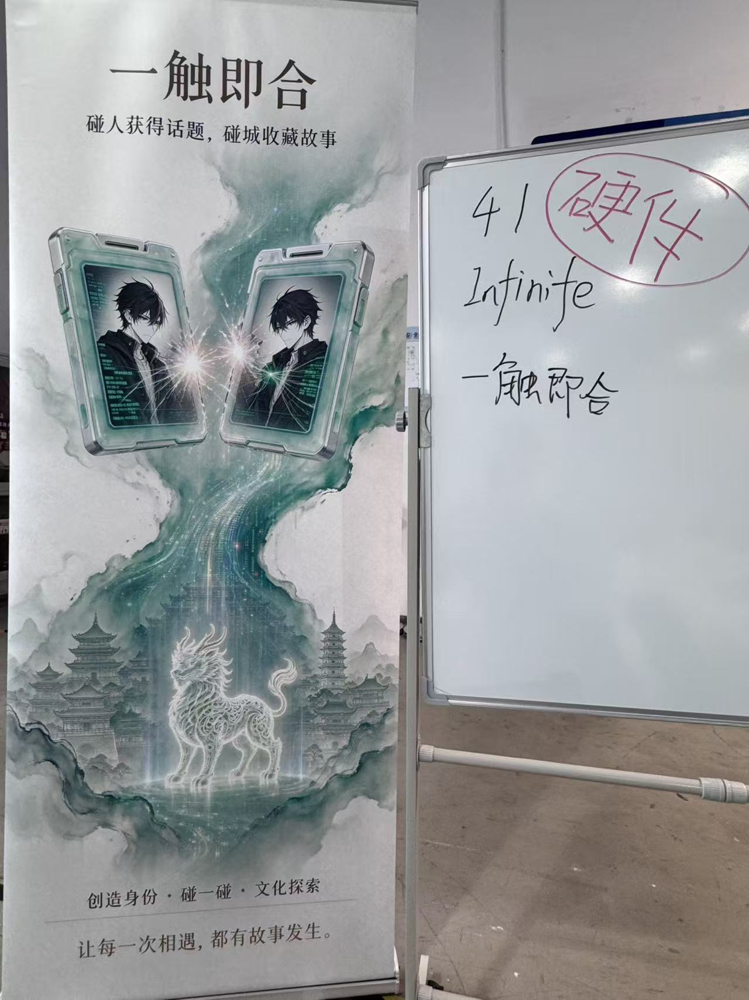
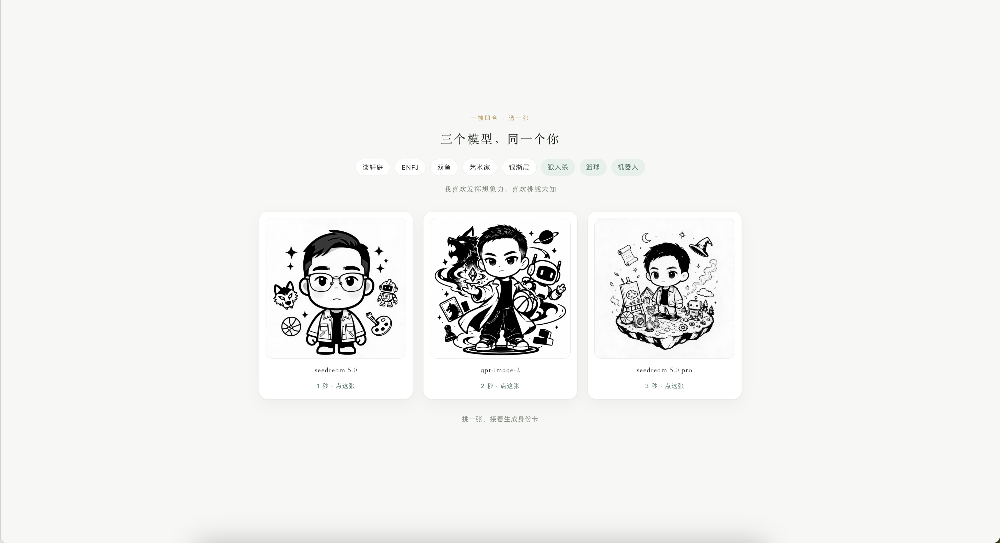
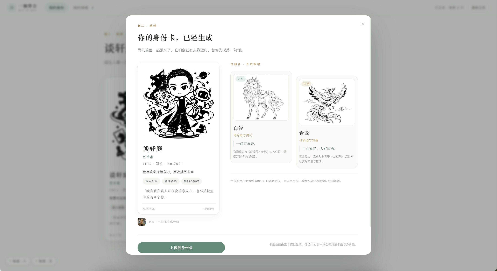
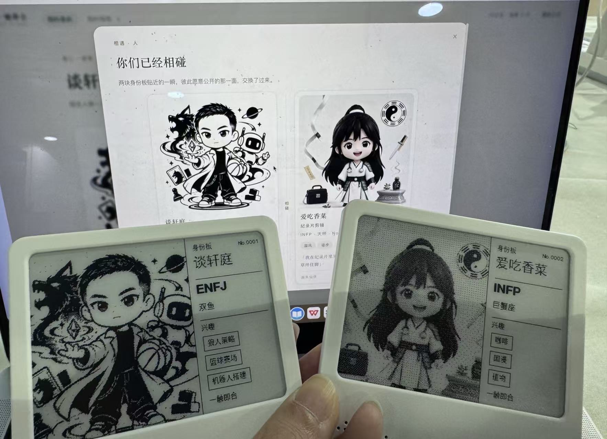
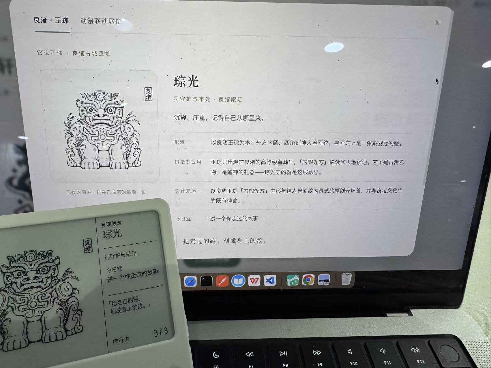

# 一触即合 Hit-it-off

这是我在一次黑客松上做的小项目：一块电子墨水屏徽章。你在网页上填几个标签，AI 会画出一张你的人物卡，然后通过板子自己开的热点传上去，墨水屏上当场显示出这张卡。



## 为什么做这个

我的想法很简单：见到陌生人的时候，不是不会聊，而是不知道第一句话说什么。所以想让 AI 帮每个人画一张「别人看得懂」的身份卡——你喜欢狼人杀、篮球、机器人，卡上就会有这些元素。两块板子碰一碰，互相能看见对方的兴趣，话题就有了。

## 我做了什么

整个流程在网页上走完：

1. **填表**。昵称、MBTI、星座、兴趣标签、一句想说的话，就这么多。
2. **三个模型同时画同一个人**。seedream 5.0、gpt-image-2、seedream 5.0 pro 各画一张，谁先画完谁先能选。现场版为了不等太久，把等待压缩成了 1/2/3 秒，先后顺序和真实耗时一致。



3. **选一张，揭晓身份卡**。选中的那张决定卡面插画，系统还会送两只《山海经》瑞兽（白泽司问、青鸾司说）。



4. **上传到墨水屏**。网页通过板子自建的热点（`HitItOff`），把 400×300 的 1-bit 画面一帧一帧推给板子，屏幕当场从空白刷出这张卡。



5. **文化联动**。这次还做了良渚限定的守护兽「琮光」，灵感来自良渚玉琮「外方内圆」的形制。文化内容的部分我给自己定了个规矩：馆藏、年代、出处这些史实来自确认过的资料，AI 只负责把文案写得好懂，不编历史。



## 怎么跑起来

demo 是纯静态页面：

```bash
cd demo
python3 -m http.server 8000
# 浏览器打开 http://localhost:8000
```

上板需要一块刷好固件的徽章（硬件是 TuyaOpen T5AI 模组 + 400×300 墨水屏）。固件在 `demo/firmware/`，用 TuyaOpen SDK 构建；板端提供了 `/ping`、`/frame`、`/state`、`/clear` 几个极简接口，`diag.html` 可以做连接自检。帧存在 RAM 里，复位就清空，开机自动刷一次空白屏。

## 目录

```
demo/
├── index.html / app.js / styles.css   网页流程
├── board.js                           上板协议：探活、逐帧写入、状态核对
├── pick-frames.js / board-frames.js   预烤好的 1-bit 整帧（base64）
├── diag.html                          板端连接自检页
├── assets/                            界面素材
├── firmware/                          板端固件源码（C，TuyaOpen SDK）
└── tools/                             渲染与联调辅助脚本（Python）
